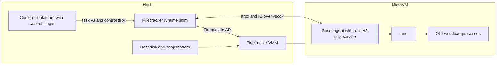

# firecracker-containerd architecture

This document describes the runtime on the upstream-migration development
branch, `work/upstream-firecracker`. It selects containerd 2.3.7, **official,
unmodified Firecracker and jailer v1.18.0 release binaries**, and runc 1.4.2.
Release archives are checksum-pinned. The SDK is published in
`vhive-serverless/firecracker-go-sdk`, branch `firecracker-v1.18.0`, at
`dd9db322432989b96cff7a38a64703d60b6cabf9`; exact inputs are in
[versions.json](modernization/versions.json).

The [migration status](modernization/upstream-migration.md) separates current
implementation from validation. Full VM snapshot/restore and vHive acceptance
of this stack remain pending. The [branch guide](modernization/README.md) and
Step 1–4 receipts describe earlier milestone revisions, including custom VMM/SDK
forks; their acceptance does not transfer to this migration. Step 1/2 branch
renames and clean sequential histories are planned, not yet published.

## Host and guest boundary

The [control plugin](../firecracker-control) is compiled into the custom
containerd binary. Its [control API](../proto/service/fccontrol/fccontrol.proto) manages VMs
that can contain multiple containers. It forwards requests to the per-VM shim.
The [runtime shim](../runtime) implements containerd's runtime-v2 integration
using the **task/v3 ttrpc API** and current shim-manager bootstrap. Runtime-v2
and task/v3 name different interfaces; containerd's major release is 2.x.

The shim runs on the host. It controls VMM startup/shutdown, devices, networking,
resource configuration and recovery, and forwards task operations to the guest.
Firecracker also runs on the host and provides the microVM through KVM. Its
optional host runc jail is distinct from the guest runc used for OCI containers.

The [agent](../agent) runs **inside the microVM**. It embeds containerd's
`containerd-shim-runc-v2/task` implementation rather than launching a separate
runc shim daemon for every container. It invokes the guest runc binary to create
and manage OCI processes, forwards events and metrics, and carries process IO
over vsock. The guest kernel supplies namespaces and cgroup v2 isolation.

## Filesystems and VM snapshots

The Step 1 baseline used an immutable SquashFS guest base with a tmpfs guest
overlay upper. Step 4 defaults that upper to a private host-disk ext4 image;
default non-stargz container writable roots remain separate devmapper-backed
ext4 devices. The guest-root overlay, container writable root, exported host
volumes and temporary mounts are separate storage layers. The optional guest
stargz path has its own storage. Its store and container overlay upper/work
directories bind to the private guest-upper filesystem at
`/rom/overlay/stargz`; they share that disk's capacity and snapshot lifetime.
The historical clean `06b55e3` acceptance run passed four stargz storage profiles
under both jailer modes and 12 stargz native restore cases. See the
[Step 4 completeness report](modernization/step-4-completeness.md) and
[verification receipt](modernization/evidence/step4-stargz/clean-06b55e3/verification.json)
for results and limits. Stargz workload lower layers remain FUSE-backed; the
storage tests do not establish cold lazy-fetch behavior. Optional pmem/DAX
applies to the immutable guest base, not the FUSE lowers.

Containerd's filesystem snapshotter prepares container image layers and writable
roots. In the default path, devmapper supplies the host block device containing
the container's ext4 filesystem. This is separate from a Firecracker VM snapshot,
which records guest memory and VMM state and still requires matching disk
contents. Capturing only files from a live filesystem cannot reproduce the block
metadata and journal referenced by captured guest memory.

The native runtime checkpoint implementation coordinates workload pause,
transport preparation, VMM pause and exported-volume capture. It records memory,
VMM state, complete attached disk images and runtime metadata in an artifact;
restore verifies and copies those inputs into a private workspace. Writable
restore images are independent files, even when the source device was provided
by devmapper. The legacy vHive path keeps its separate workload-disk capture and
restore into a newly allocated devmapper device. A VM snapshot alone does not
clone that device. External host writers to exported volumes must also be
quiescent; the VM gate cannot stop them.

Upstream Firecracker reopens captured device paths. The runtime maps each
restore's selected backing at those paths inside a private VMM filesystem:
OCI mounts for jailed VMMs, or a private mount root for unjailed VMMs. It does not
rewrite source paths in the host namespace. Native restores can therefore use
their copied disks after the original source paths disappear; legacy callers
must supply their independently restored workload backing. Immutable pmem
backing is verified and mapped read-only. See
[restore mount preparation](../runtime/restore_mounts.go) and
[native restore](../runtime/native_restore.go) for the implementation.

## Snapshot transport and incremental features

Official snapshot creation resets established vsock connections. The runtime
now implements reconnectable control clients, an acknowledged guest lifecycle
event journal, and framed stdin/stdout/stderr with byte cursors and explicit
end-of-stream state. Snapshot preparation drains accepted I/O to a matching
host/guest barrier and waits for host event publication before sealing a cut.
Source resume reconnects and checks the streams before releasing read gates and
the tasks it paused. Restored processes retain guest FIFO ownership and receive
new host endpoints and session identities. Native artifact version 2 and the
legacy version 2 drive sidecar require transport cut version 1. These are
implemented protocol rules; component tests have not established full VM
acceptance. See the [snapshot contract](modernization/upstream-migration.md#snapshot-contract)
for failure handling and limits.

Step 2 adds vHive-managed snapshot/restore for its documented standalone profile.
Step 3 adds a CRI frontend, ordinary Kubernetes RuntimeClass support and native
checkpoint/restore components. Step 4 adds a private disk-backed guest upper,
optional immutable pmem/DAX backing, and DAMON with free-page reporting. These
features do not imply full CRI conformance or Kubernetes Pod restore. Kubernetes
Pod checkpoint/restore is deferred to the 1.38 interface work; this is separate
from CRI conformance and Step 4's native runtime restore. Consult the milestone
documents for supported profiles, measured results and open gates.

The original [design alternatives](design-approaches.md) and
[shim design](shim-design.md) explain historical decisions. Their proposals and
old diagrams are design history, not current implementation or acceptance claims.
