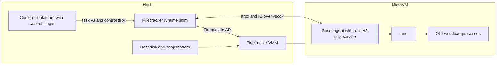

# firecracker-containerd architecture

This document describes the maintained runtime foundation. See the
[branch guide](modernization/README.md) for the incremental Step 1–4 features,
exact dependency pins and acceptance limits. The stack uses containerd 2.3.7,
Firecracker based on v1.18.0, and runc 1.4.2. VMM and SDK fork revisions differ
by branch and are pinned in that branch's `docs/modernization/versions.json`.

## Host and guest boundary

The [control plugin](../firecracker-control) is compiled into the custom
containerd binary. Its [control API](../proto/service/fccontrol/fccontrol.proto) manages VMs
that can contain multiple containers. It forwards requests to the per-VM shim.
The [runtime shim](../runtime) implements containerd's runtime-v2 integration
using the **task/v3 ttrpc API** and current shim-manager bootstrap. Runtime-v2
and task/v3 name different interfaces; containerd's major release is 2.x.

The shim runs on the host. It controls VMM startup/shutdown, devices, networking,
resource configuration and recovery, and forwards task operations to the guest.
Firecracker also runs on the host and provides the microVM through KVM. Its
optional host runc jail is distinct from the guest runc used for OCI containers.

The [agent](../agent) runs **inside the microVM**. It embeds containerd's
`containerd-shim-runc-v2/task` implementation rather than launching a separate
runc shim daemon for every container. It invokes the guest runc binary to create
and manage OCI processes, forwards events and metrics, and carries process IO
over vsock. The guest kernel supplies namespaces and cgroup v2 isolation.

## Storage and incremental features

The Step 1 baseline used an immutable SquashFS guest base with a tmpfs guest
overlay upper. Step 4 defaults that upper to a private host-disk ext4 image;
default non-stargz container writable roots remain separate devmapper-backed
ext4 devices. The guest-root overlay, container writable root, exported host
volumes and temporary mounts are separate storage layers. The optional guest
stargz path has its own storage. Its store and container overlay upper/work
directories bind to the private guest-upper filesystem at
`/rom/overlay/stargz`; they share that disk's capacity and snapshot lifetime.
The clean `06b55e3` acceptance run passed four stargz storage profiles under
both jailer modes and 12 stargz native restore cases. See the
[Step 4 completeness report](modernization/step-4-completeness.md) and
[verification receipt](modernization/evidence/step4-stargz/clean-06b55e3/verification.json)
for results and limits. Stargz workload lower layers remain FUSE-backed; the
storage tests do not establish cold lazy-fetch behavior. Optional pmem/DAX
applies to the immutable guest base, not the FUSE lowers.

Step 2 adds vHive-managed snapshot/restore for its documented standalone profile.
Step 3 adds a CRI frontend, ordinary Kubernetes RuntimeClass support and native
checkpoint/restore components. Step 4 adds a private disk-backed guest upper,
optional immutable pmem/DAX backing, and DAMON with free-page reporting. These
features do not imply full CRI conformance or Kubernetes Pod restore. Kubernetes
Pod checkpoint/restore is deferred to the 1.38 interface work; this is separate
from CRI conformance and Step 4's native runtime restore. Consult the milestone
documents for supported profiles, measured results and open gates.

The original [design alternatives](design-approaches.md) and
[shim design](shim-design.md) explain historical decisions. Their proposals and
old diagrams are design history, not current implementation or acceptance claims.
