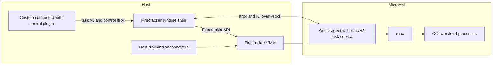

# firecracker-containerd architecture

This document describes the maintained runtime foundation. See the
[branch guide](modernization/README.md) for the incremental Step 1–4 features,
exact dependency pins and acceptance limits. The stack uses containerd 2.3.7,
official Firecracker v1.18.0 and runc 1.4.2. The published vHive SDK revision
and release checksums are pinned in `docs/modernization/versions.json`.

## Host and guest boundary

The [control plugin](../firecracker-control) is compiled into the custom
containerd binary. Its [control API](../proto/firecracker.proto) manages VMs
that can contain multiple containers. It forwards requests to the per-VM shim.
The [runtime shim](../runtime) implements containerd's runtime-v2 integration
using the **task/v3 ttrpc API** and current shim-manager bootstrap. Runtime-v2
and task/v3 name different interfaces; containerd's major release is 2.x.

The shim runs on the host. It controls VMM startup/shutdown, devices, networking,
resource configuration and recovery, and forwards task operations to the guest.
Firecracker also runs on the host and provides the microVM through KVM. Its
optional host runc jail is distinct from the guest runc used for OCI containers.

The [agent](../agent) runs **inside the microVM**. It embeds containerd's
`containerd-shim-runc-v2/task` implementation rather than launching a separate
runc shim daemon for every container. It invokes the guest runc binary to create
and manage OCI processes, forwards events and metrics, and carries process IO
over vsock. The guest kernel supplies namespaces and cgroup v2 isolation.

## Agent transport

The guest retains lifecycle events in a bounded acknowledged journal. The host
publishes each event before acknowledging it, and retries delivery across agent
connection replacement without discarding the host publication cursor. Retained
Wait calls use the stable task client; mutating task operations are not replayed.

Framed stdin/stdout/stderr streams keep FIFO ownership independent of the network
connection. Reconnecting a stream retains accepted bytes, FINs and acknowledgements.
The reusable Prepare/Describe/Resume operations coordinate stream read gates and
matching process cursors. Step 1 does not persist a snapshot cut or coordinate VM
capture; those operations are introduced with the snapshot consumer in Step 2.
See [migration scope and validation](modernization/upstream-migration.md).

## Storage and incremental features

Step 1 preserves an immutable SquashFS guest base with a tmpfs guest overlay
upper; default devmapper container writable roots are already separate ext4
block devices backed by host storage. The guest-root overlay, container writable
root, exported host volumes and temporary mounts are separate storage layers.
The optional guest stargz path has its own storage and must be assessed separately.

Step 2 adds vHive-managed snapshot/restore for its documented standalone profile.
Step 3 adds a CRI frontend, ordinary Kubernetes RuntimeClass support and native
checkpoint/restore components. Step 4 adds a private disk-backed guest upper,
optional immutable pmem/DAX backing, and DAMON with free-page reporting. These
features do not imply full CRI conformance or Kubernetes Pod restore. Consult
the milestone documents for supported profiles, measured results and open gates.

The original [design alternatives](design-approaches.md) and
[shim design](shim-design.md) explain historical decisions. Their proposals and
old diagrams are design history, not current implementation or acceptance claims.
